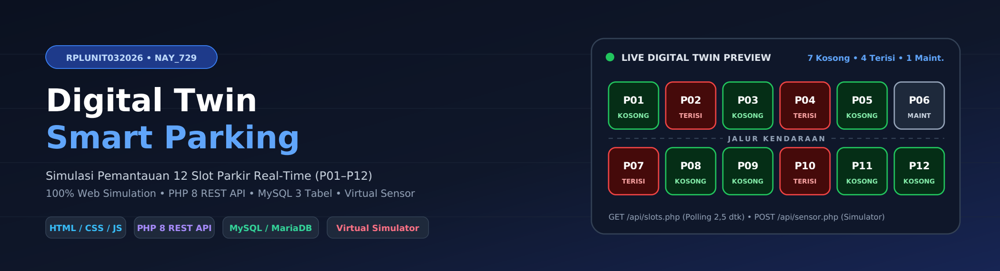
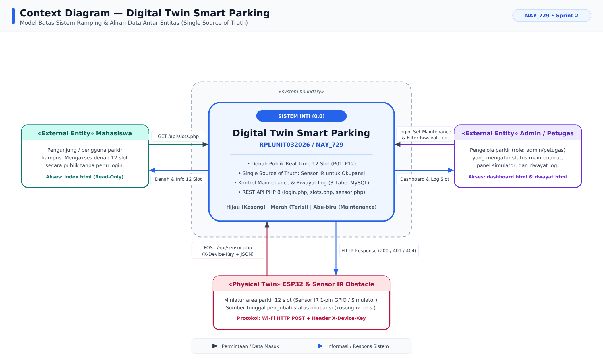
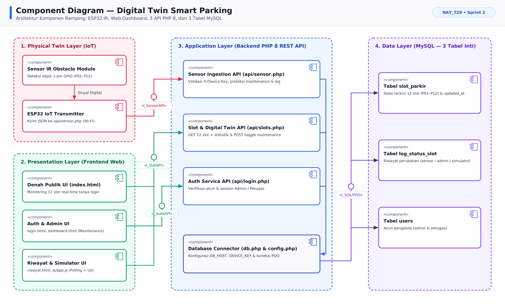

<p align="center">
  
</p>

<p align="center">
  
  
  
  
  
</p>

<p align="center">
  <a href="./sprint-1/1_panduan-proyek.md">📘 Panduan Proyek</a> •
  <a href="./sprint-1/2_rancangan-sistem.md">⚙️ Rancangan Sistem</a> •
  <a href="./sprint-1/3_rancangan-ui-ux.md">🎨 UI/UX</a> •
  <a href="./sprint-1/4_function-point.md">📊 Function Point</a> •
  <a href="./sprint-1/5_kerangka-dasar.md">💻 Kerangka Dasar</a> •
  <a href="./sprint-2/README.md">🖼️ Galeri 8 Diagram (Sprint 2)</a>
</p>

---

> [!NOTE]
> **Ruang Lingkup Simulasi:** Proyek **Digital Twin Smart Parking (`NAY_729`)** dibangun sebagai **simulasi perangkat lunak murni (tanpa prototipe hardware fisik)**. Perubahan kondisi area parkir pada 12 slot (`P01`–`P12`) dihasilkan oleh **Modul Simulator Sensor (`js/simulator.js`)** bermode manual & *auto-simulation* yang tersinkronisasi *real-time* ke dashboard web melalui REST API.

## ✨ Fitur & Prinsip Arsitektur

- **🎯 Single Source of Truth (Anti-Konflik):** Status okupansi slot (`kosong` ↔ `terisi`) hanya diubah oleh **Modul Simulator Sensor** melalui `POST /api/sensor.php`, sedangkan **Admin / Petugas** hanya mengatur kunci `maintenance` dan memantau riwayat log.
- **🛡️ Proteksi Maintenance Otomatis:** Event simulator untuk slot yang sedang `maintenance` otomatis diabaikan oleh backend agar status perbaikan tidak tertimpa.
- **👀 Denah Publik Tanpa Login:** Mahasiswa dapat langsung memantau ketersediaan 12 slot (`P01`–`P12`) di `index.html` dengan pembaruan *polling* otomatis tiap 2,5 detik.
- **🗄️ Skema Database Ramping (3 Tabel Inti):** Cukup menggunakan `users`, `slot_parkir`, dan `log_status_slot` di MySQL/MariaDB tanpa tabel transaksi yang redundant.

## 🚦 Indikator Status Slot (`P01`–`P12`)

| Status | Warna Denah | Sumber Perubahan | Keterangan |
|:------:|:-----------:|------------------|------------|
| 🟢 `kosong` | Hijau (`#22C55E`) | Simulator Sensor / Admin *(selesai maintenance)* | Slot tersedia untuk parkir |
| 🔴 `terisi` | Merah (`#EF4444`) | Simulator Sensor *(Manual / Auto-Simulation)* | Kendaraan terdeteksi (simulasi) |
| ⚪ `maintenance` | Abu-biru (`#64748B`) | Admin / Petugas | Slot dikunci sementara (event simulator diabaikan) |

## 👥 Tim Pengembang (`RPLUNIT032026 / NAY_729`)

| No | Nama Lengkap | NIM | Fokus Peran |
|---:|--------------|-----|-------------|
| 1 | **Muhammad Nabil** | `240504087` | Backend PHP 8 REST API & Database MySQL |
| 2 | **Ariel Rizky Ardiansyah** | `240504082` | Desain UI/UX, Frontend Denah, & Dokumentasi UML |
| 3 | **Yana Putra Hamdalah** | `240504079` | Modul Simulator Sensor (`simulator.js`) & Pengujian |

## 📂 Struktur Repositori

```text
NAY_729/
├── README.md                        # Ringkasan proyek & navigasi utama
├── assets/
│   └── banner.png                   # Hero banner repositori GitHub
├── sprint-1/                        # Dokumen analisis & perancangan sistem
│   ├── 1_panduan-proyek.md          # Ruang lingkup simulasi, jadwal, & pembagian tim
│   ├── 2_rancangan-sistem.md        # Arsitektur anti-konflik, 3 tabel, & REST API
│   ├── 3_rancangan-ui-ux.md         # Wireframe 4 halaman web & panel simulator
│   ├── 4_function-point.md          # Perhitungan Function Point (9 fungsi • 39,52 AFP)
│   └── 5_kerangka-dasar.md          # Boilerplate SQL, PHP 8 API, & JS Simulator
└── sprint-2/                        # Galeri 8 diagram pemodelan UML & arsitektur
    ├── README.md                    # Indeks visual seluruh diagram Sprint 2
    ├── 1_context-diagram.png
    ├── 2_use-case-diagram.png
    ├── 3_activity-diagram.png
    ├── 4_sequence-diagram.png
    ├── 5_class-diagram.png
    ├── 6_state-diagram.png
    ├── 7_deployment-diagram.png
    └── 8_component-diagram.png
```

## 🖼️ Cuplikan Arsitektur (Sprint 2)

<details open>
<summary><b>Klik untuk melihat Context Diagram &amp; Component Diagram (Lihat semua 8 diagram di <a href="./sprint-2/README.md">sprint-2/README.md</a>)</b></summary>
<br />
<p align="center">
  
</p>
<p align="center">
  
</p>
</details>

## 🚀 Roadmap & Progres Sprint

- [x] **Sprint 1 — Analisis & Fondasi Sistem:** Dokumen panduan simulasi, rancangan sistem 3 tabel, desain UI/UX, estimasi Function Point (`39,52 AFP`), dan kerangka dasar kode.
- [x] **Sprint 2 — Pemodelan UML & Arsitektur:** 8 diagram perancangan sistem resolusi tinggi (Context, Use Case, Activity, Sequence, Class, State, Deployment, Component).
- [ ] **Sprint 3 — Implementasi & Demo Simulasi:** Pengkodean aplikasi web, REST API PHP 8, panel simulator manual/otomatis, dan pengujian sinkronisasi *end-to-end*.
