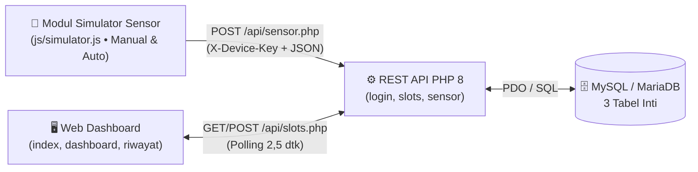

> [⬅️ 1. Panduan Proyek](./1_panduan-proyek.md) &nbsp;|&nbsp; [🏠 README](../README.md) &nbsp;|&nbsp; [3. Rancangan UI/UX ➡️](./3_rancangan-ui-ux.md)

# ⚙️ Rancangan Sistem — Simulasi Digital Twin Smart Parking (`NAY_729`)

## 1. Alur Arsitektur Simulasi (4 Lapisan Logis)

> [!TIP]
> **Single Source of Truth (Anti-Konflik):** Status okupansi (`kosong` ↔ `terisi`) hanya diubah lewat `POST /api/sensor.php` (Simulator), sedangkan status `maintenance` hanya diubah lewat `POST /api/slots.php` (Admin). Jika sebuah slot sedang `maintenance`, event simulator akan otomatis diabaikan (`status: "ignored"`).

## 2. Alur Proses Utama

### A. Sinkronisasi Event Simulator (`POST /api/sensor.php`)
1. Admin memicu event simulasi (klik manual pada slot `P01`–`P12` atau menyalakan mode *Auto-Simulation*).
2. `js/simulator.js` mengirim HTTP `POST /api/sensor.php` dengan header `X-Device-Key` dan payload JSON (`nomor_slot`, `status`, `device_id`, `timestamp`).
3. Backend memvalidasi `X-Device-Key` (`401`), format payload (`400`), dan keberadaan slot (`404`).
4. Backend memeriksa status slot di tabel `slot_parkir`:
   - Jika sedang `maintenance` → abaikan event dan kembalikan `{"status": "ignored"}`.
   - Jika status berubah → `UPDATE slot_parkir` dan `INSERT INTO log_status_slot (sumber = 'simulator')`.

### B. Monitoring Denah Real-Time (`GET /api/slots.php`)
1. Mahasiswa (tanpa login) atau Admin membuka halaman denah web.
2. `js/app.js` melakukan *polling* ke `GET /api/slots.php` setiap 2,5 detik.
3. Frontend memperbarui warna 12 kartu slot (`Hijau`, `Merah`, `Abu-biru`) serta angka statistik tanpa reload halaman.

### C. Manajemen Status Maintenance (`POST /api/slots.php`)
1. Admin/Petugas login via `POST /api/login.php`.
2. Admin memilih slot (misalnya `P07`) lalu mengaktifkan atau menonaktifkan mode `maintenance`.
3. Backend memperbarui `slot_parkir` dan mencatat perubahan dengan `sumber = 'admin'` pada `log_status_slot`.

## 3. Skema Database (3 Tabel Inti)

| Tabel | Kolom Utama | Fungsi |
|-------|-------------|--------|
| `users` | `id_user` (PK), `nama`, `email` (UNIQUE), `password_hash`, `role` (`admin`/`petugas`), `created_at` | Autentikasi pengelola sistem |
| `slot_parkir` | `id_slot` (PK), `nomor_slot` (`P01`–`P12`, UNIQUE), `status` (`kosong`/`terisi`/`maintenance`), `updated_at` | Menyimpan state terkini 12 slot Digital Twin |
| `log_status_slot` | `id_log` (PK), `id_slot` (FK), `status_lama`, `status_baru`, `sumber` (`simulator`/`admin`), `device_id`, `created_at` | Audit trail perubahan status slot |

## 4. Spesifikasi REST API

| Method & Endpoint | Autentikasi | Payload Request | Respons Sukses (`200 OK`) |
|-------------------|-------------|-----------------|---------------------------|
| `POST /api/login.php` | Publik | `{"email": "admin@parkir.test", "password": "..."}` | `{"status": "ok", "user": {"nama": "...", "role": "admin"}}` |
| `GET /api/slots.php` | Publik | *(opsional `?with_logs=1`)* | `{"summary": {"total": 12, "kosong": 8, "terisi": 3, "maintenance": 1}, "slots": [...]}` |
| `POST /api/slots.php` | Session Admin | `{"nomor_slot": "P07", "status": "maintenance"}` | `{"status": "ok", "message": "Slot P07 diubah ke maintenance"}` |
| `POST /api/sensor.php` | `X-Device-Key` | `{"nomor_slot": "P03", "status": "terisi", "device_id": "SIM-WEB-01"}` | `{"status": "ok", "nomor_slot": "P03", "state": "terisi"}` |

---
> [⬅️ 1. Panduan Proyek](./1_panduan-proyek.md) &nbsp;|&nbsp; [🏠 README](../README.md) &nbsp;|&nbsp; [3. Rancangan UI/UX ➡️](./3_rancangan-ui-ux.md)
