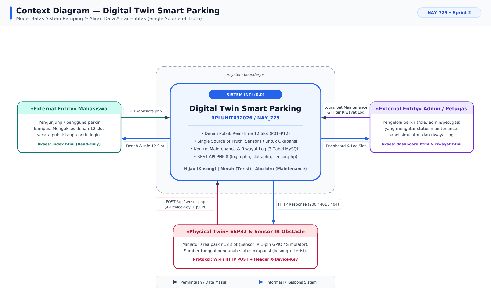
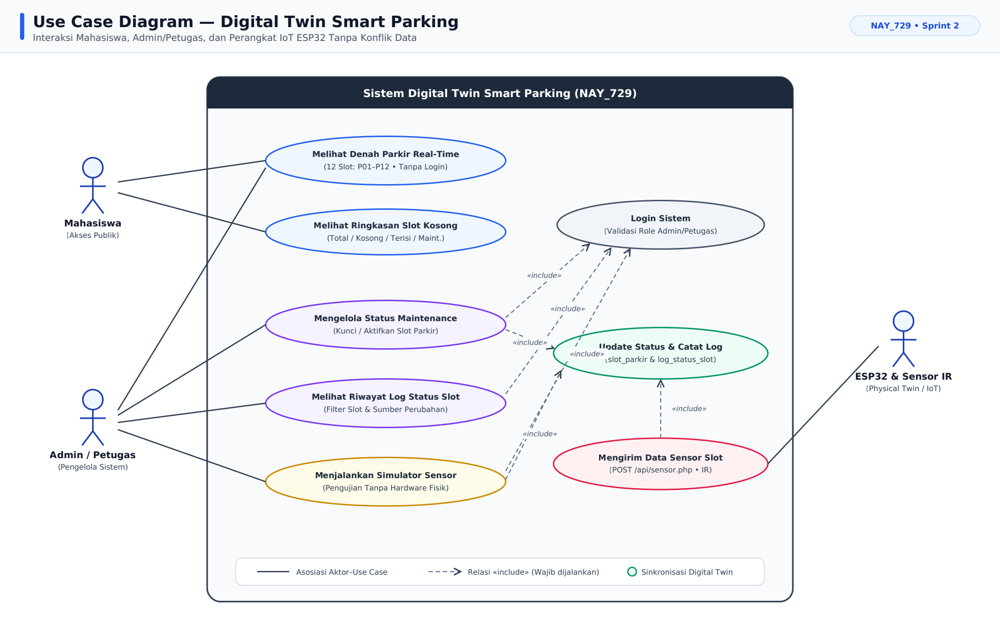
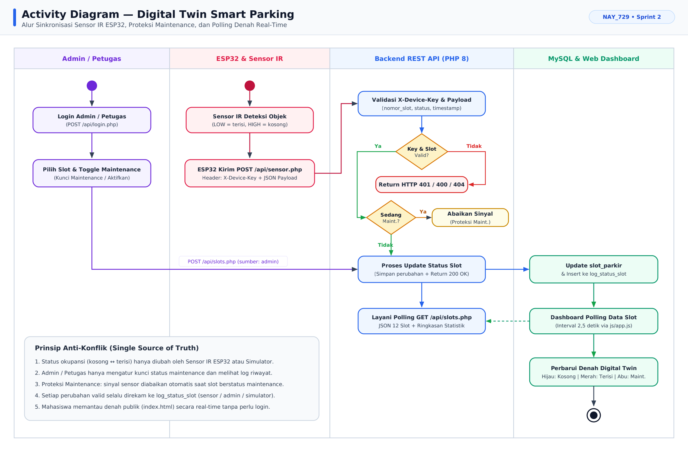
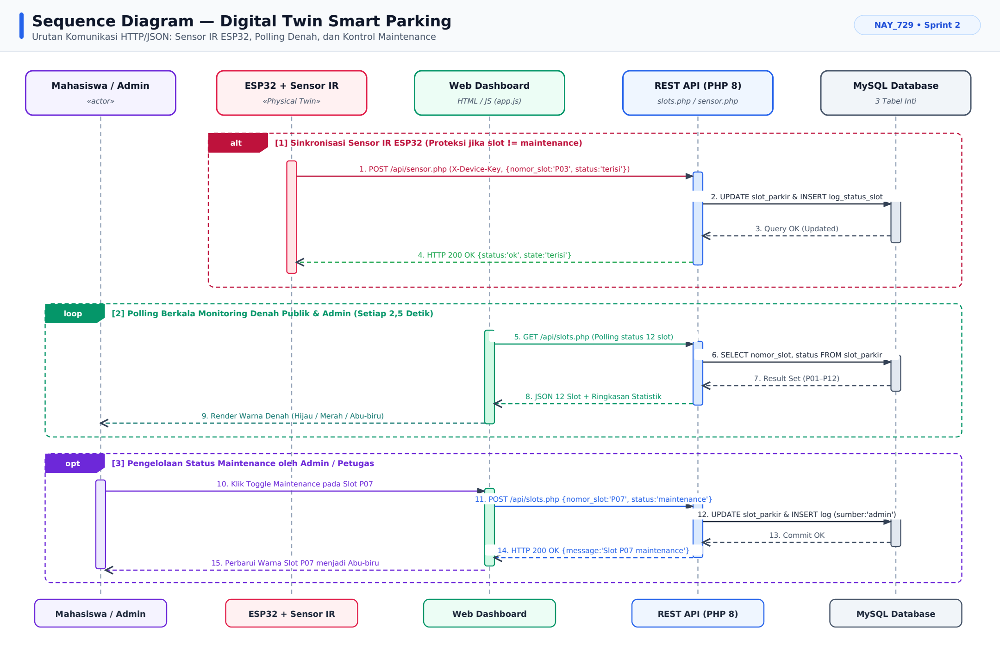
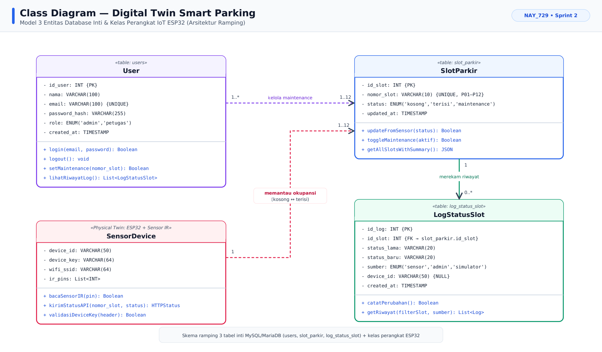
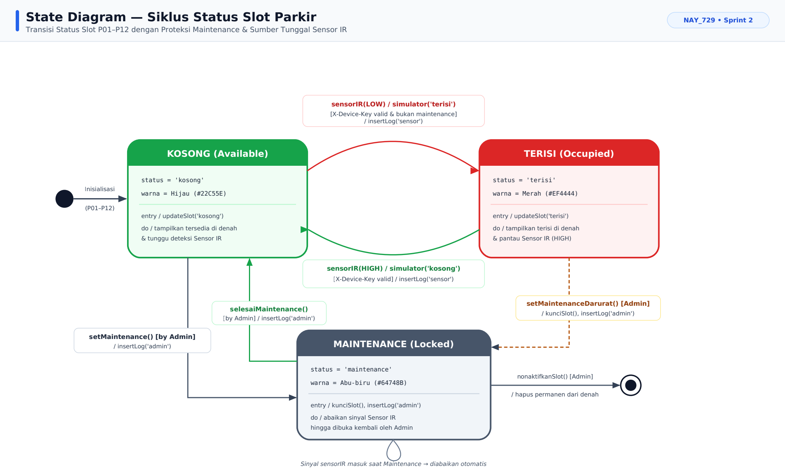
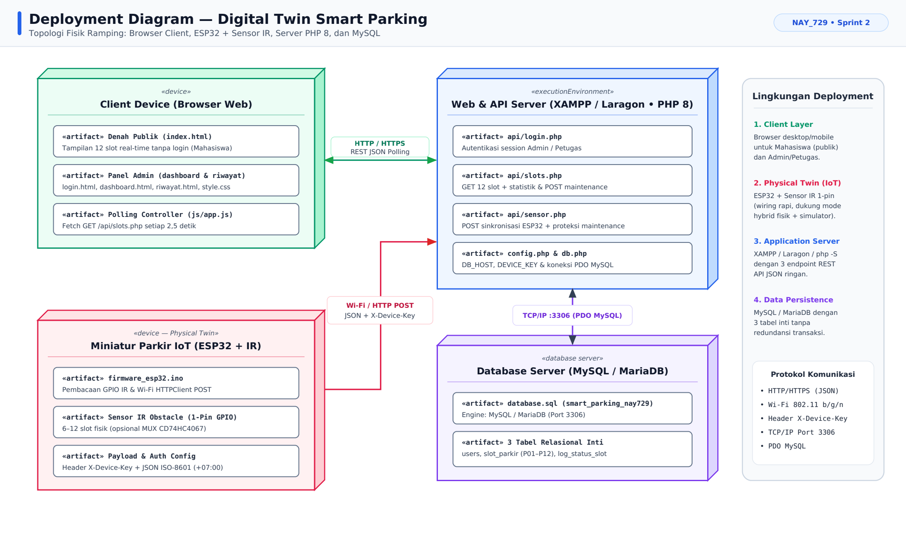
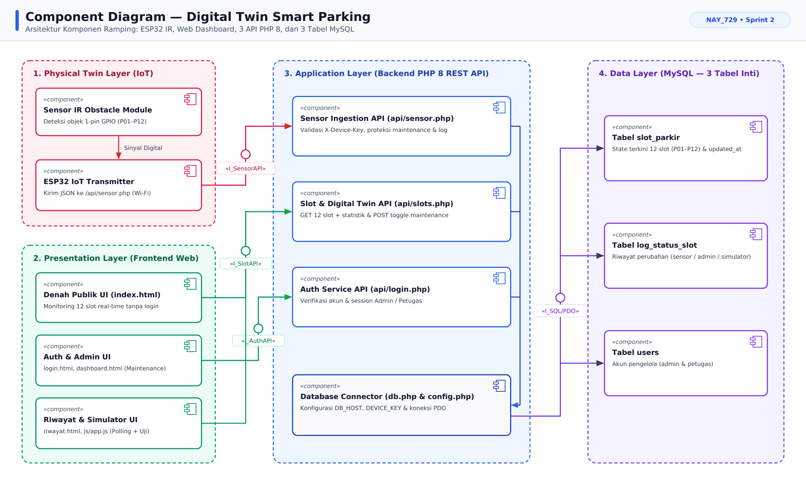

> [⬅️ Kembali ke README Utama](../README.md) &nbsp;|&nbsp; [📘 Dokumen Sprint 1](../sprint-1/1_panduan-proyek.md)

# 🖼️ Sprint 2 — Galeri 8 Diagram Pemodelan Sistem (`NAY_729`)

> [!NOTE]
> Seluruh 8 diagram di bawah ini telah diselaraskan dengan ruang lingkup **100% simulasi perangkat lunak (tanpa prototipe fisik)** pada `sprint-1/` — menggunakan 3 tabel inti MySQL, REST API PHP 8, dan **Modul Simulator Sensor (`js/simulator.js`)**.

## 📑 Daftar Isi Cepat

| No | Diagram | File PNG | Ringkasan |
|---:|---------|----------|-----------|
| 1 | [Context Diagram](#1-context-diagram) | `1_context-diagram.png` | Batas sistem & aliran data antar entitas |
| 2 | [Use Case Diagram](#2-use-case-diagram) | `2_use-case-diagram.png` | Interaksi Mahasiswa, Admin/Petugas, & Simulator |
| 3 | [Activity Diagram](#3-activity-diagram) | `3_activity-diagram.png` | Alur event simulator, proteksi maintenance, & *polling* |
| 4 | [Sequence Diagram](#4-sequence-diagram) | `4_sequence-diagram.png` | Urutan komunikasi HTTP/JSON & MySQL |
| 5 | [Class Diagram](#5-class-diagram) | `5_class-diagram.png` | Struktur 3 tabel inti + kelas `ParkingSimulator` |
| 6 | [State Diagram](#6-state-diagram) | `6_state-diagram.png` | Siklus status slot (`Kosong`, `Terisi`, `Maintenance`) |
| 7 | [Deployment Diagram](#7-deployment-diagram) | `7_deployment-diagram.png` | Topologi aplikasi web 3-tier |
| 8 | [Component Diagram](#8-component-diagram) | `8_component-diagram.png` | Arsitektur komponen & antarmuka antar lapisan |

---

### 1. Context Diagram
Menggambarkan batas sistem Digital Twin Smart Parking dan aliran data dua arah dengan Mahasiswa, Admin/Petugas, serta Modul Simulator Sensor.

### 2. Use Case Diagram
Memetakan seluruh fungsionalitas inti sistem berdasarkan aktor tanpa konflik antara kontrol admin dan event simulator.

### 3. Activity Diagram
Menunjukkan alur aktivitas lengkap mulai dari pemicuan simulasi, validasi `X-Device-Key`, proteksi slot `maintenance`, hingga pembaruan denah secara *real-time*.

### 4. Sequence Diagram
Memperlihatkan urutan pertukaran pesan HTTP/JSON antara Modul Simulator, Web Dashboard, REST API PHP 8, dan MySQL.

### 5. Class Diagram
Menampilkan struktur 3 tabel database (`users`, `slot_parkir`, `log_status_slot`) beserta relasinya terhadap kelas `ParkingSimulator`.

### 6. State Diagram
Memodelkan transisi siklus status slot `P01`–`P12` (`Kosong`, `Terisi`, `Maintenance`), termasuk aturan pengabaian event simulator saat `Maintenance`.

### 7. Deployment Diagram
Menjelaskan topologi aplikasi web simulasi (Client Browser & Modul Simulator ↔ Web/API Server PHP 8 ↔ Database Server MySQL).

### 8. Component Diagram
Menguraikan pembagian komponen perangkat lunak ke dalam 4 lapisan (Simulation, Presentation, Application, Data) beserta antarmukanya.

---
> [⬅️ Kembali ke README Utama](../README.md) &nbsp;|&nbsp; [📘 Dokumen Sprint 1](../sprint-1/1_panduan-proyek.md)
